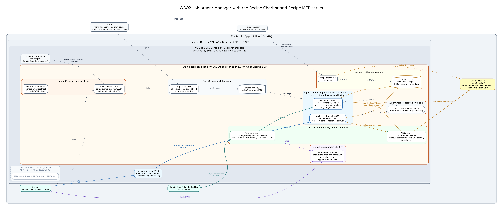

# WSO2 & OpenChoreo Developer Lab

Welcome to the **WSO2 & OpenChoreo Development Lab**. This repository provides a fully containerized, reproducible, and isolated sandbox environment for experimenting with WSO2 products and Kubernetes-native integration platforms without cluttering your local host machine.

---

## 🏛️ System Architecture & Strategy

This environment utilizes **VS Code Dev Containers** powered by **Docker-in-Docker (DinD)** and lightweight **k3d (Kubernetes in Docker)**.

```text
+-------------------------------------------------------------------------+
| Host Operating System                                                   |
|   - Visual Studio Code                                                  |
|   - Docker Engine (Rancher Desktop / Docker Desktop)                    |
|   - Zero native JDK, MySQL, Helm, or Host-level K8s dependencies        |
|                                                                         |
|   +-----------------------------------------------------------------+   |
|   | VS Code Dev Container (/workspace)                              |   |
|   |   - OpenJDK / Go / Python Tooling                               |   |
|   |   - Helm, kubectl, k3d CLIs                                     |   |
|   |                                                                 |   |
|   |   +---------------------------------------------------------+   |   |
|   |   | Isolated k3d Kubernetes Cluster (wso2-cluster)          |   |   |
|   |   |   - WSO2 API Manager / Identity Server                  |   |   |
|   |   |   - Micro Integrator                                    |   |   |
|   |   |   - OpenChoreo & ThunderID                              |   |   |
|   |   |   - WSO2 Agent Manager                                  |   |   |
|   |   +---------------------------------------------------------+   |   |
|   +-----------------------------------------------------------------+   |
+-------------------------------------------------------------------------+
```

The full architecture of the Agent Manager scenario, with the recipe chatbot and MCP server:



The diagram's source is [docs/architecture.dot](docs/architecture.dot); re-render it with
`bash docs/render-diagrams.sh`.

### Key Advantages:

1. **Host Cleanliness**: All Java runtimes, database instances, CLI tools, and Kubernetes clusters run strictly inside container layers.
2. **Instant Team Onboarding**: Teammates can clone this repo and launch a fully operational cluster with a single click in VS Code.
3. **No Port Conflicts**: Port mappings are isolated within container network namespaces.
4. **Disposable Environments**: Resetting messy cluster states takes under 30 seconds.

---

## 📁 Repository Structure

```text
.
├── .devcontainer/
│   ├── devcontainer.json     # Container definition, features, & port forward specs
│   └── Dockerfile            # Base image customization and CLI tool installations
├── scripts/
│   ├── init-environment.sh   # Creates the k3d cluster + NGINX ingress (runs on container create)
│   ├── reset-cluster.sh      # Deletes and recreates an empty cluster
│   └── lib.sh                # Shared helpers (versions, logging, /etc/hosts, Helm recovery)
├── tutorials/
│   ├── 01-api-manager/
│   │   └── apk-gateway/      # APIM 4.5 control plane + APK 1.3 gateway
│   │       ├── README.md     # How to run and use this demo on its own
│   │       ├── install.sh    # Deploys APK, APIM and the APK agent
│   │       ├── populate.sh   # Creates a sample API/app/subscription and calls it via APK
│   │       ├── uninstall.sh  # Removes the scenario, keeps the cluster
│   │       └── values/       # Upstream Helm values + local overrides
│   └── 02-agent-manager/
│       ├── quick-start/      # WSO2 Agent Manager 1.0 on OpenChoreo (own cluster: amp-local)
│       │   ├── README.md     # How to run and use this demo on its own
│       │   ├── install.sh    # Runs the official quick-start image's installer
│       │   ├── recover.sh    # Repairs the cluster after a Mac / Docker VM restart
│       │   ├── uninstall.sh  # Removes the platform (--delete-cluster removes the cluster)
│       │   └── common.sh     # Image version + helpers for the installer container
│       └── recipe-chatbot/   # RAG recipe chatbot agent on Agent Manager (needs quick-start)
│           ├── README.md     # How it works, how to run it, troubleshooting
│           ├── setup.sh      # Qdrant + recipe ingest, Ollama LLM provider, ThunderID user/app
│           ├── deploy.sh     # Builds/deploys the agent from GitHub, secures it with ThunderID
│           ├── web.sh        # Serves the React web app on http://localhost:5173
│           ├── setup-mcp.sh  # Publishes the recipe catalog as an MCP server (API-key secured)
│           ├── agent/        # The agent's code (its own GitHub repo)
│           ├── ingest/       # recipes.json -> embeddings -> Qdrant (Kubernetes Job)
│           └── web/          # React web app (ThunderID sign-in)
└── README.md                 # Project documentation
```

---

## 🚀 Quick Start Guide

### Prerequisites

Ensure the following tools are installed on your host machine:

* [Docker Desktop](https://www.docker.com/) or [Rancher Desktop](https://rancherdesktop.io/) (*Note: Disable Rancher Desktop's built-in Kubernetes cluster in settings*).
* [Visual Studio Code](https://code.visualstudio.com/).
* VS Code **Dev Containers** Extension (`ms-vscode-remote.remote-containers`).

### Launching the Lab

1. Clone this repository to your computer, including the recipe agent's code, which is a
   [Git submodule](https://git-scm.com/book/en/v2/Git-Tools-Submodules)
   (`tutorials/02-agent-manager/recipe-chatbot/agent` → `martinwjones/recipe-chat-agent`):

   ```bash
   git clone --recurse-submodules <repository-url>
   cd wso2
   ```

   Already cloned without it? Run `git submodule update --init`.
2. Open the folder in Visual Studio Code:

   ```bash
      code .
   ```

3. Press `Cmd + Shift + P` (or `Ctrl + Shift + P`) to open the VS Code Command Palette.
4. Select **Dev Containers: Reopen in Container**.
5. Wait for the container image to build and execute `scripts/init-environment.sh`.
6. Deploy a scenario. Each one has its own README with the details:
   [API Manager + APK](tutorials/01-api-manager/apk-gateway/README.md) and
   [Agent Manager](tutorials/02-agent-manager/quick-start/README.md).

   APIM with APK as the gateway
   ([upstream guide](https://apk.docs.wso2.com/en/latest/control-plane/apk-as-gateway-in-apim/apk-as-gateway-in-apim-qsg/)):
   ```bash
   bash tutorials/01-api-manager/apk-gateway/install.sh    # ~10-15 min on first run
   bash tutorials/01-api-manager/apk-gateway/populate.sh   # sample API -> APK, calls it
   ```
   Or WSO2 Agent Manager ([upstream guide](https://wso2.com/agent-platform/docs/v1.0.0/get-started/quick-start/)):
   ```bash
   bash tutorials/02-agent-manager/quick-start/install.sh  # ~15-20 min, needs 8 GB for Docker
   ```
   Then the [recipe chatbot](tutorials/02-agent-manager/recipe-chatbot/README.md) on top of it.
   After a Mac or Docker restart, run `tutorials/02-agent-manager/quick-start/recover.sh`.
   All scripts are safe to re-run, including after a disconnect or container rebuild.

### Switching Between Scenarios
Each scenario's cluster needs most of an 8 GB Docker VM, so run one at a time.
Stopping a cluster keeps everything installed:
```bash
k3d cluster list                     # wso2-cluster = tutorial 01, amp-local = tutorial 02
k3d cluster stop amp-local && k3d cluster start wso2-cluster
```
The scenario scripts select their own cluster, so `kubectl` points at whichever one ran last
(check with `kubectl config current-context`).

---

## 🔌 Port Mappings

The following ports are published to your host machine by Docker (`appPort` in `.devcontainer/devcontainer.json`), so they must be free on the host. Stop anything else using 80/443, such as another local Kubernetes ingress:

| Port | Target Application / Service |
| :--- | :--- |
| `443` | NGINX ingress: APIM Publisher / Devportal / Admin at `https://am.wso2.com` |
| `80` | NGINX ingress (HTTP) |
| `9095` | APK gateway at `https://default.gw.wso2.com:9095` |
| `8080` | Agent Manager console at `http://console.amp.localhost:8080` (also API and Thunder login) |
| `8443` | OpenChoreo control plane (HTTPS) |
| `11080` | OpenChoreo observer API (traces and logs in the console) |
| `19080` / `19443` | OpenChoreo data plane gateway (deployed agents) |
| `5173` | Recipe chatbot web app at `http://localhost:5173` |

The `*.amp.localhost` names need no hosts entry: browsers resolve `*.localhost` to `127.0.0.1`.

The hostnames resolve to `127.0.0.1` inside the container automatically. To open the portals
from a browser on your host, add this line to the host's `/etc/hosts`
(`C:\Windows\System32\drivers\etc\hosts` on Windows):

```
127.0.0.1 am.wso2.com api.am.wso2.com idp.am.wso2.com default.gw.wso2.com
```

Default credentials: `admin` / `admin`. The certificates are self-signed, so accept the browser warning.

---

## 🛠️ Daily Workflow Cheat Sheet

Run these commands in the VS Code terminal inside your Dev Container:

### Cluster & Pod Status
```bash
# Verify cluster node status
kubectl get nodes

# View all running pods across namespaces
kubectl get pods -A
```

### Working with Helm
```bash
# Add official WSO2 Helm repository
helm repo add wso2 https://helm.wso2.com
helm repo update
```

### Complete Environment Reset
If you want to tear down your Kubernetes environment and recreate it from scratch:
```bash
# Delete existing cluster and re-run initialization
bash ./scripts/reset-cluster.sh
```

---

## 👥 Team Onboarding Notes
When adding new tutorials or multi-product scenarios:
1. Store Kubernetes manifests, values files, and custom scripts under the corresponding directory in `tutorials/`.
2. Document scenario-specific data pre-population or credential overrides in a `README.md` inside that tutorial's folder.